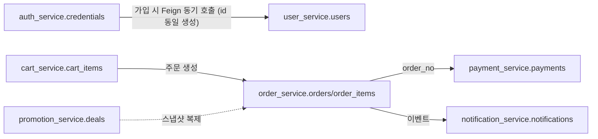

# [설명] 초기 데이터베이스 스키마

## 개요

SSG-DEAL의 8개 서비스 중 DB가 필요한 7개 서비스(게이트웨이 제외) 각각이 소유하는 초기 테이블 구조다. MSA의 Database per Service 원칙에 따라 서비스마다 자신의 스키마만 읽고 쓰며, 서비스 간에는 FK 없이 `BIGINT` 식별자와 애플리케이션 레벨의 호출/이벤트로만 연결된다.

## 동작 방식

- 회원가입: `auth_service`가 인증(로그인/회원가입/토큰 발급)을 책임진다. `credentials`를 만든 뒤 **내부 API(Feign)로 `user_service`를 동기 호출**해 같은 `id`로 `users`(프로필)를 만든다. 이후 프로필 조회·수정은 모두 `user_service`의 책임이며 `auth_service`는 관여하지 않는다.
- 주문: `order_service`가 `promotion_service`의 딜 정보를 조회해 `order_items`에 이름·가격을 스냅샷으로 복제한 뒤 주문을 생성한다. 이후 결제는 `order_no`를 공유키로 `payment_service`와 연결된다.
- 알림: 주문/결제 상태 변화 등을 Kafka 이벤트로 받아 `notification_service`가 `notifications`에 기록하고 Slack 등으로 발송한다(이벤트 연동 상세는 이후 스펙에서 다룸).



## 주요 구성 요소 / 위치

| 구성 요소 | 역할 | 위치 |
|-----------|------|------|
| `credentials` | 로그인 자격 증명(이메일/비밀번호/권한) | `auth_service` — `ssgdeal_auth` |
| `users`, `addresses` | 회원 프로필, 배송지 | `user_service` — `ssgdeal_user` |
| `carts`, `cart_items` | 장바구니 | `cart_service` — `ssgdeal_cart` |
| `deals`, `deal_options` | 특가 딜(판매 단위), 옵션 | `promotion_service` — `ssgdeal_promotion` |
| `orders`, `order_items` | 주문, 주문 상품(스냅샷) | `order_service` — `ssgdeal_order` |
| `payments` | 결제 | `payment_service` — `ssgdeal_payment` |
| `notifications` | 알림 발송 로그 | `notification_service` — `ssgdeal_notification` |

## 설정 / 사용법

로컬에서는 `docker-compose.yml`로 MySQL 컨테이너 하나를 띄우면 컨테이너 초기화 스크립트가 7개 스키마와 서비스별 전용 유저를 함께 만든다. 각 서비스는 자신의 스키마에만 접속 권한이 있는 유저로 연결한다(실행 방법: [app-run-guide.md](../../app-run-guide.md)).

## 예시

```sql
-- order_service가 결제 완료 후 조회하는 예시
SELECT o.order_no, o.status, oi.item_name, oi.quantity
FROM orders o
JOIN order_items oi ON oi.order_id = o.id
WHERE o.order_no = '20261013ab12cd34';
```

## 관련 문서

- [docs/conventions/database.md](../../conventions/database.md) — 공통 규약(SOT)
- [docs/conventions/backend.md](../../conventions/backend.md) — Flyway, 레이어드 구조
- [database.md](database.md) — 전체 DDL
- [legacy-reference.md](legacy-reference.md) — 이전 Java 프로젝트의 실제 DDL(참고용, 현재 설계 아님)
