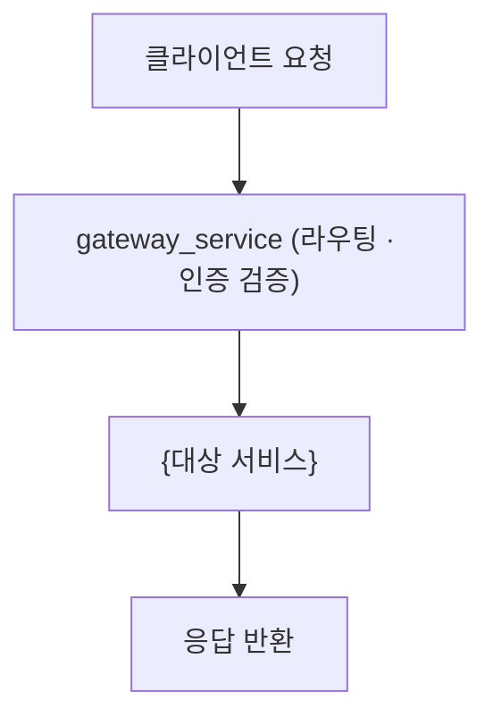

<!--
이 파일은 "프로젝트 README 템플릿"입니다. (docs/template/specs/* 와 같은 템플릿 모음의 일부)
저장소 루트의 README.md를 작성할 때 이 파일을 복사해 채우세요.
- {중괄호}는 프로젝트 값으로 교체합니다.
- 해당 없는 섹션은 통째로 삭제합니다.
- 안내용 주석은 작성 후 모두 지웁니다.
- SSG-DEAL은 Gradle 멀티모듈로 구성된 Kotlin/Spring Boot MSA 백엔드 모노레포입니다
  (프론트엔드 없음). 서비스가 여러 개이므로 설치·실행·의존성 섹션을 서비스별로
  나누기보다는, 공통 실행 방법(Gradle/Docker Compose) 하나로 묶고 서비스별 차이만
  표로 정리하는 편을 권장합니다.
섹션 순서(개요 → 설치/실행 → 구조 → 흐름 → 기능 위치 → 의존성 → 코드 스타일 → 유지관리)는
그대로 유지하길 권장합니다.
-->

# {프로젝트명}

{한두 문장 소개 — 무엇을 하는 서비스인지, 어떤 기반 기술 위에 있는지, MSA 구조 한 줄 요약}

> AI 코딩 에이전트로 작업한다면 먼저 [docs/AGENT_GUIDE.md](docs/AGENT_GUIDE.md)를 읽으세요.

## 주요 기능

### 🎯 핵심 기능

<!-- 사용자/도메인 관점의 핵심 기능 -->
- **{기능}**: {설명}

### 🏗️ 아키텍처 특징

<!-- 구조적 특징 (예: 모듈형 모노레포 구성, 서비스 간 통신 방식, API Gateway 경계 등) -->
- **{특징}**: {설명}

## 서비스 구성

| 서비스 | 책임 | 포트 |
|--------|------|------|
| `gateway_service` | API Gateway — 라우팅·{추가 책임} | {포트} |
| `auth_service` | {책임} | {포트} |
| `user_service` | {책임} | {포트} |
| `cart_service` | {책임} | {포트} |
| `order_service` | {책임} | {포트} |
| `payment_service` | {책임} | {포트} |
| `promotion_service` | {책임} | {포트} |
| `notification_service` | {책임} | {포트} |

## 요구사항

- **JDK**: {버전}
- **Kotlin**: {버전}
- **Gradle**: Wrapper 포함 (`./gradlew`)
- {필수 외부 의존 — MySQL, Redis, Kafka 등}

## 설치 및 설정

```bash
./gradlew build
```

### 환경 변수 설정

서비스별 `src/main/resources/application.yml` 또는 `.env`에 다음을 설정합니다:

```bash
# {그룹 — 예: DB 접속 정보}
{KEY}={값/설명}

# {그룹 — 예: 외부 연동 키}
{KEY}={값/설명}
```

## 실행 방법

### 로컬에서 서비스 하나만 실행

```bash
./gradlew :{service}_service:bootRun
```

### 전체 스택 실행 (Docker Compose)

```bash
{docker compose 명령}
```

- **용도**: {}
- **특징**: {핵심 동작·주의점}

## 프로젝트 구조

Gradle 멀티모듈 — 각 `*_service`는 독립된 Spring Boot 애플리케이션입니다.

```text
.
├── gateway_service/        # API Gateway
├── auth_service/           # {책임}
├── user_service/           # {책임}
├── cart_service/           # {책임}
├── order_service/          # {책임}
├── payment_service/        # {책임}
├── promotion_service/      # {책임}
├── notification_service/   # {책임}
└── docs/                   # 문서 (AGENT_GUIDE, specs, template)
```

> 새 서비스 모듈을 추가하면 `settings.gradle.kts`에 등록하고, 이 트리와 아래 '서비스 구성' 표를 함께 갱신해야 합니다.

## 실행 파이프라인 / 핵심 흐름

{요청이 Gateway로 들어와 각 서비스로 라우팅되고 응답이 돌아오기까지의 핵심 흐름. 가능하면 mermaid로.}



<!-- 흐름의 핵심 분기, 서비스 간 동기/비동기 통신 방식 등을 하위 섹션(###)으로 보충 -->

## 주요 기능과 위치

기능을 수정할 때 **어느 서비스를 건드려야 하는지**를 정리합니다.

| 기능 | 설명 | 위치 |
|------|------|------|
| **{기능}** | {한 줄 설명} | `{service}_service/...` |

> 위 표는 기능이 **어디 있는지**를 가리킵니다. 개별 기능의 **상세 설명**은 이 README에 중복해 적지 않고, 해당 기능 스펙의 `description.md`를 단일 출처(SOT)로 둡니다. 특정 기능 설명이 필요하면 `docs/specs/{NNN}-{기능}/description.md`를 참고/링크하세요.

## 패키지 의존성

### 공통/주요 의존성

| 패키지 | 버전 | 설명 |
| ------ | ---- | ---- |
| `{패키지}` | `{버전}` | {용도} |

## 코드 스타일

```bash
{포맷터/린터 명령}     # 예: ./gradlew ktlintCheck
```

설정은 `{설정 파일}`에 있습니다. {반드시 지킬 핵심 규칙 한 줄}

### 자주 쓰는 라이브러리·패턴

<!-- 이 프로젝트에서 일관되게 쓰는 방식. 새 코드가 따라야 할 규칙. -->
- **{패턴}**: {설명}

## 유지 관리 사항

### {성능 튜닝 / 운영 설정}

- `{설정값}`: {의미와 조정 기준}

### 보안

- {시크릿 관리, 운영 환경 설정 등}

### 의존성 업데이트

```bash
{의존성 업데이트 명령}
```
